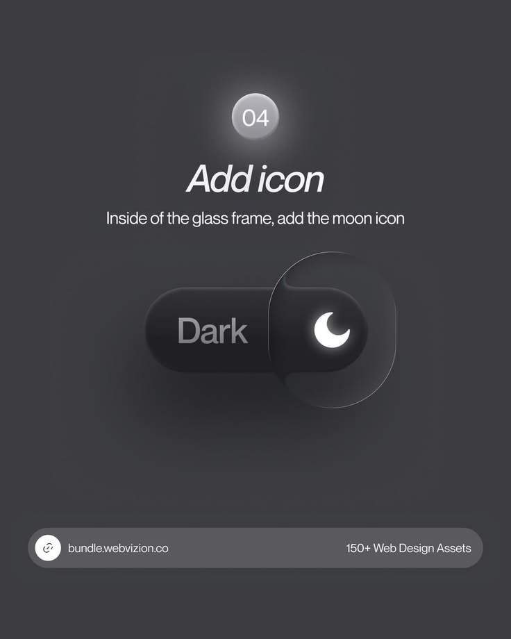

# Add Moon Icon Glass Toggle Tutorial

**Discipline:** print-social ·  · **Design style:** Glassmorphism
**Tags:** tutorial, dark, glass, toggle, moon, step-04, neumorphic

## What it is
A charcoal tutorial post, step 04, with a glowing number bubble, italic title 'Add icon', a line about adding the moon icon inside the glass frame, and a dark toggle labelled Dark with a translucent glass knob holding a glowing moon, plus the bundle footer.

## What it means
A single glowing moon inside a glass knob is a clear, satisfying final touch.

## Techniques
- Glass knob refracting the dark toggle
- Glowing white icon as the focal point
- Muted grey label to keep focus on the icon
- Number bubble with halo
- Series footer bar

## Best for
- UI effect tutorial series
- Dark mode toggle design
- Glassmorphism lessons

## Vocabulary
- **Glass knob** — A translucent handle on a toggle.
- **Glow icon** — An icon with a soft luminous halo.
- **Step bubble** — A numbered circle marking a step.
