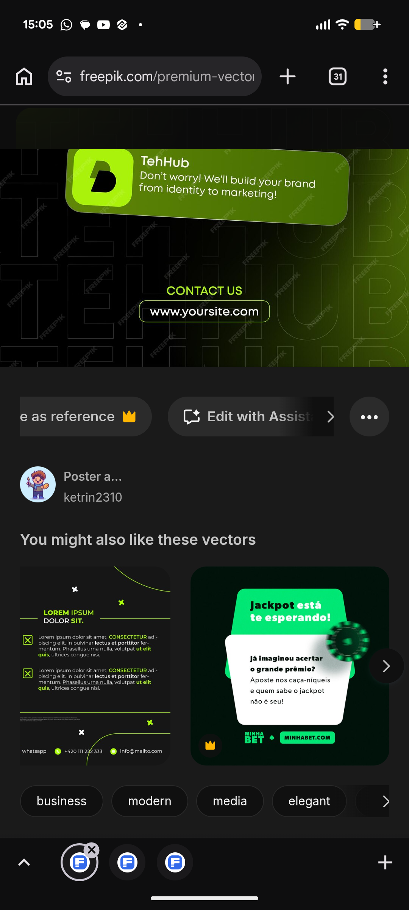

# Green Checklist and Jackpot Card Templates

**Discipline:** print-social ·  · **Design style:** Corporate & Clean-Tech
**Tags:** checklist, green, dark, cards, promo, template, vector

## What it is
A stock-vector page showing two related templates below a lime-lit hero: a dark post with a lime heading, two checkbox items and curved lime lines with contact icons at the base, and a dark green square post with a mint tilted headline card over a white card and a chip graphic.

## What it means
Curved neon lines and checkbox bullets give a dark template a technical polish, and stacked tilted cards give the promo depth.

## Techniques
- Curved thin lime lines crossing a dark canvas
- Checkbox icons as bullets
- Small x marks as decorative accents
- Stacked tilted headline cards
- Contact icons anchored to the base

## Best for
- Promo and announcement templates
- Dark green brand systems
- Benefit-list posts

## Vocabulary
- **Checkbox bullet** — A boxed tick used in place of a list dot.
- **Line accent** — A thin curved line used as decoration.
- **Stacked cards** — Overlapping cards giving a layered look.
