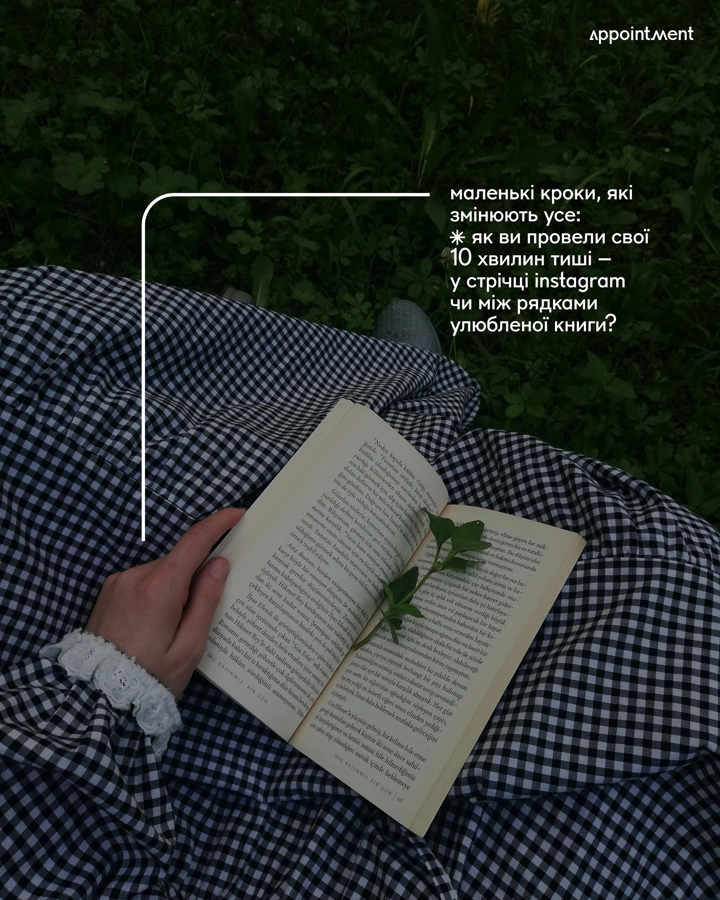

# Dim garden reading photo with a white elbow line leading to a wellness question

**Discipline:** print-social · **Design type:** Social cover post
**Tags:** wellness, photo, dark-green, gingham, white-line, callout, minimal, ukrainian

## What it is
A darkened top-down photo of a hand holding an open book with a sprig on a navy gingham skirt over grass. A thin white line rises and bends to a paragraph at the upper right asking about 10 minutes of quiet, with a small wordmark at the top right.

## What it means
Quiet and intimate; the single leader line turns a photo into a gentle prompt.

## Techniques
- Use a thin rounded-corner line to link the photo to the text.
- Darken the photo so white type is legible.
- Keep text in a narrow block at the edge.
- Use one asterisk as a bullet.

## Best for
- Mindfulness and wellness posts
- Photo-led quiet quotes
- Minimal editorial covers

## Vocabulary
- **Leader line** — A line connecting a point in an image to text.
- **Dark scrim** — A dim layer over a photo.
- **Gingham texture** — A small checked fabric pattern.
- **Quiet post** — A design with very little on it.
