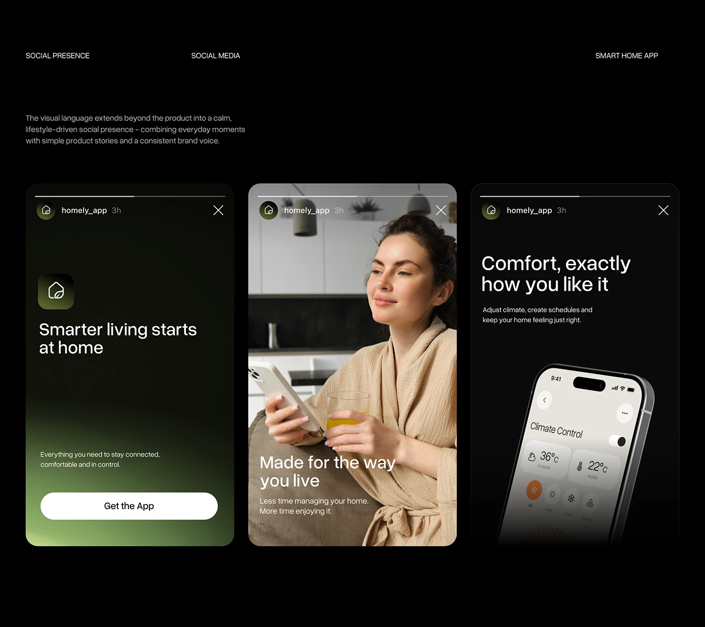

# Dark Smart-Home App Story Set

**Discipline:** print-social · **Design type:** Story set
**Tags:** stories, dark, green, lifestyle, app, phone, portrait

## What it is
Three vertical Instagram stories on black: a green-gradient logo tile, a lifestyle photo with headline, and a tilted phone showing climate controls.

## What it means
Near-black with a green glow feels calm, modern and eco-smart. Mixing photos, type and UI keeps the set varied.

## Techniques
- Consistent story chrome with progress bars and handle
- Green gradient glow rising from the bottom edge
- Big friendly sentence-case headlines
- White pill CTA at the story foot
- Alternating type, photo and product frames

## Best for
- Smart-home and lifestyle apps
- Instagram story campaigns
- Dark-mode brand systems

## Vocabulary
- **Story chrome** — The platform's progress bars and header drawn around the artwork.
- **Glow gradient** — A soft colored light rising from an edge.
- **Product story** — A story that shows the product in use.
