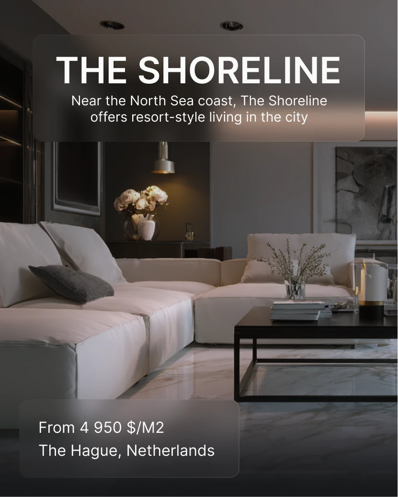

# Property post over a dim luxury living room with two frosted glass cards

**Discipline:** print-social ·  · **Design style:** Glassmorphism
**Tags:** real-estate, luxury, interior, dark, frosted-glass, white-caps, portrait, price

## What it is
A tall photo of a cream sofa and marble floor in a moodily lit room. A large frosted card at top holds the bold white title 'THE SHORELINE' and a two-line subhead; a smaller frosted card at the bottom shows price per square metre and city.

## What it means
Calm, upscale and quiet; glass cards keep the photograph legible and elegant.

## Techniques
- Use two frosted glass panels, top and bottom, to frame a photo.
- Set the title in bold caps and the subhead in light weight.
- Choose a warm low-light interior photograph.
- Keep only one line of price info.

## Best for
- Luxury property listings
- Hospitality and interior promos
- Photo-led announcements

## Vocabulary
- **Frosted panel** — A blurred translucent rectangle laid over an image.
- **Title/subhead pair** — A bold heading with a lighter descriptive line.
- **Low-key interior** — A dim, warm-lit room photograph.
- **Price strip** — A short line stating cost and place.
