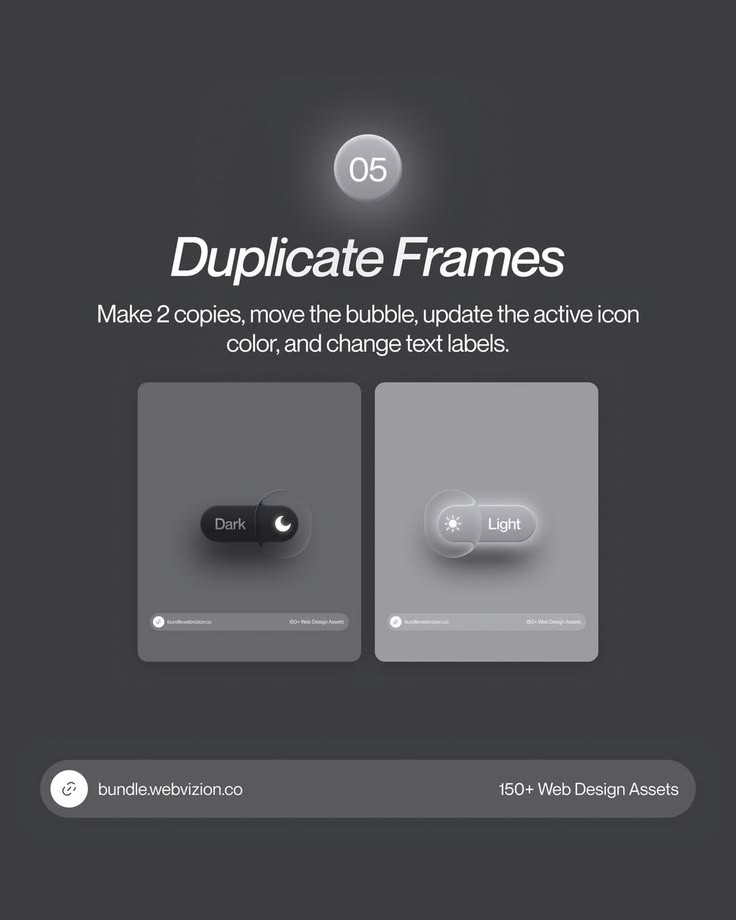

# Duplicate Frames Toggle Tutorial

**Discipline:** print-social ·  · **Design style:** Glassmorphism
**Tags:** tutorial, toggle, dark-light, step-05, frames, grey, glass

## What it is
Step 05 of a toggle tutorial: a glowing number bubble, italic heading, instruction and two side-by-side frames showing the toggle in Dark and Light states, with the link bar below.

## What it means
Showing both states side by side communicates the end result of the copy-and-edit step at a glance.

## Techniques
- Two frames displaying before and after states
- Tonal grey palette so the toggle is the hero
- Consistent step-bubble and footer system
- Small caption text inside frames for realism
- Light frame lifted slightly for contrast

## Best for
- UI micro-interaction tutorials
- Asset marketing
- Consecutive step posts

## Vocabulary
- **State pair** — Two frames showing a component in different states.
- **Toggle** — A switch control moving between two options.
- **Step series** — A sequence of numbered posts with identical layout.
