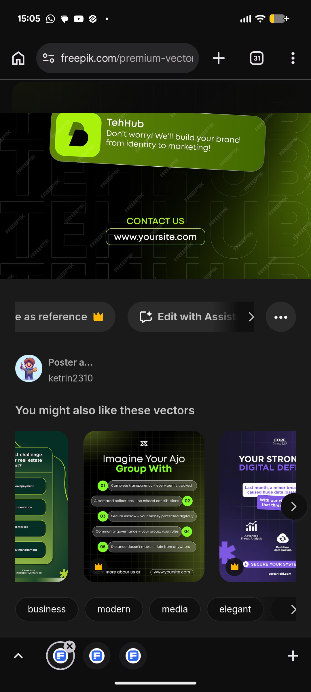

# Numbered Lime Pill List and Purple Shield Posts

**Discipline:** print-social · **Design type:** Social template pack
**Tags:** numbered-list, lime, dark, purple, pills, security, template, vector

## What it is
A stock-vector page with a dark lime-lit post above two related templates: one with a heading 'Imagine Your Ajo Group With' over five numbered pill points with lime number circles, and a purple post 'Your strong digital defence' with small icon blocks and a Secure Your System pill.

## What it means
Numbered pills make a list feel like a set of tags, and swapping the accent colour reuses one layout for another sector.

## Techniques
- Numbered lime circles beside long pill labels
- Pills alternating left and right
- Faint grid on dark green
- Same layout in a purple scheme
- Contact line and URL pill at the base

## Best for
- Feature-list social posts
- Template families in several colours
- Fintech and security content

## Vocabulary
- **Numbered pill** — A capsule of text with a number badge.
- **Colourway** — The same layout shown in a different palette.
- **Feature list post** — A post listing benefits as short labels.
