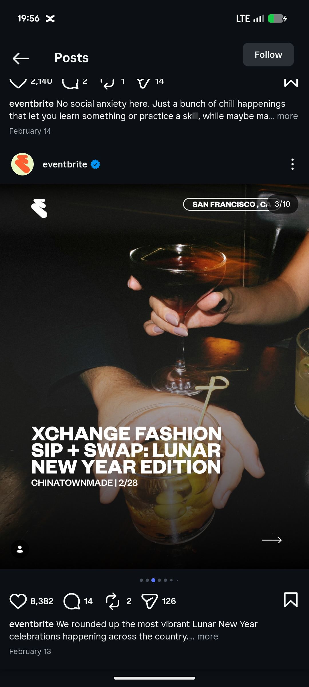

# Moody Cocktail Photo Event Cover

**Discipline:** print-social ·  · **Design style:** Photographic & Cinematic
**Tags:** event, photography, dark, cocktail, white-type, location-pill, carousel, instagram

## What it is
An Instagram carousel slide of a dark film-grain photo of hands holding a coupe glass over a whisky glass, with a small white logo top left, an outlined location pill, a heavy white sans headline 'XCHANGE FASHION SIP + SWAP: LUNAR NEW YEAR EDITION', a venue and date line and an arrow at the lower right.

## What it means
Warm low light and hands in the frame feel intimate and social, and blunt heavy type reads instantly over the dark photo.

## Techniques
- Grainy low-light photography
- Heavy white caps headline set low left
- Smaller venue and date under the title
- Outlined pill for the city
- Arrow cue for the next slide

## Best for
- Event roundup carousels
- Nightlife and social event marketing
- Photo-led text overlays

## Vocabulary
- **Film grain** — Visible noise giving photos an analog feel.
- **Location pill** — An outlined capsule naming the city.
- **Text over photo** — Type placed directly on a darkened image.
