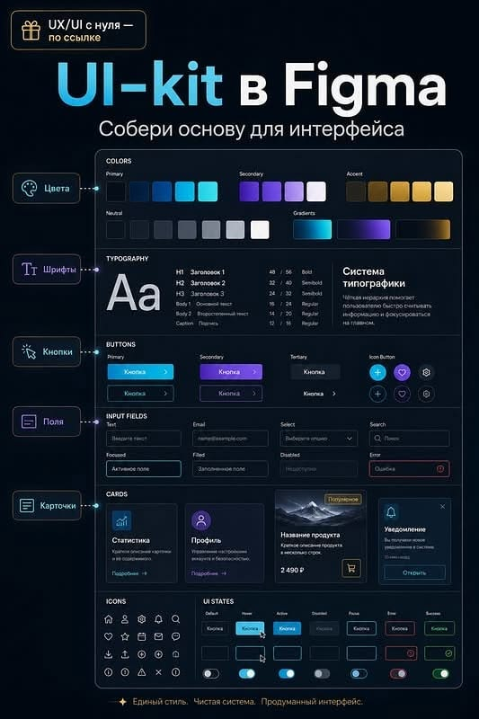

# Dark Neon UI Kit Anatomy Poster

**Discipline:** print-social ·  · **Design style:** Dark & Neon
**Tags:** ui-kit, dark, cyan, violet, poster, labels, cyrillic, infographic

## What it is
A tall dark poster with a large gradient headline, a subheading and a single framed UI-kit panel showing colour, typography, buttons, inputs, cards, icons and states, with five pill labels on the left connected by dotted lines to each section.

## What it means
Connecting pill labels to sections turns a component sheet into a clear map, and glowing cyan and violet feel modern and technical.

## Techniques
- Pill labels at the left linked by dotted lines to sections
- Gradient headline in cyan to white
- One framed sheet containing every component group
- Dark navy with neon accents
- Footer line summarising the system's promise

## Best for
- UI kit and course promotion
- Explaining design-system anatomy
- Dark tech educational posters

## Vocabulary
- **Anatomy poster** — A poster labelling the parts of a system or object.
- **Leader pill** — A label connected by a line to a part of an image.
- **Component sheet** — A board showing all elements of a UI kit together.
