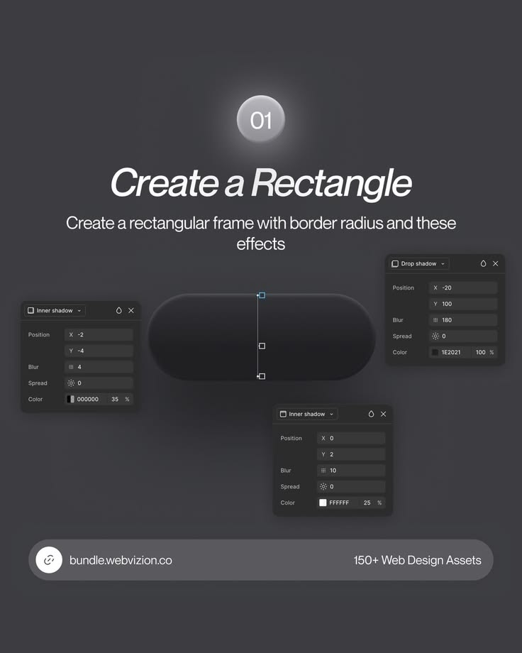

# Create a Rectangle Neumorphic Pill Tutorial

**Discipline:** print-social · **Design type:** Social educational post
**Tags:** tutorial, dark, neumorphic, effects, step-01, figma, panels

## What it is
A charcoal tutorial post with a glowing number bubble 01, an italic title 'Create a Rectangle', instructions, a dark pill shape and three floating effect panels (inner shadow and drop shadow values) linked to it, and a rounded footer bar promoting an asset bundle.

## What it means
Showing actual property values beside the shape makes the recipe reproducible, and monochrome keeps attention on the effect.

## Techniques
- Glowing number bubble as a step marker
- Property panels floating around the subject
- Inner and drop shadows to make a soft raised pill
- Italic headline for a dynamic feel
- Footer bar with link and offer

## Best for
- UI effect tutorials
- Neumorphic and soft UI lessons
- Asset bundle promotion

## Vocabulary
- **Inner shadow** — A shadow drawn inside a shape's edge.
- **Drop shadow** — A shadow cast outside and beneath a shape.
- **Effect panel** — A screenshot of tool settings used as a teaching aid.
