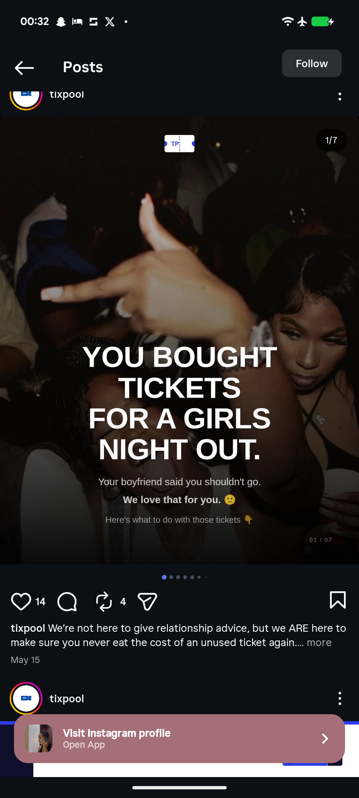

# Girls Night Out Ticket Resale Cover

**Discipline:** print-social ·  · **Design style:** Dark & Neon
**Tags:** carousel, cover, dark, party-photo, white-type, ticket-logo, tickets, instagram

## What it is
An Instagram carousel cover over a dark blurry party photograph with a small ticket logo at the top, a giant white heavy headline 'YOU BOUGHT TICKETS FOR A GIRLS NIGHT OUT.', a lighter line 'Your boyfriend said you shouldn't go.', a bold reply 'We love that for you.' and a dim pointer line, with a slide counter.

## What it means
A cheeky story-style hook over an unfocused party photo makes a ticket resale service feel like a friend's gossip.

## Techniques
- Blurry party photograph as the backdrop
- Centred giant headline with a punchline below
- Three text tiers by size and brightness
- Ticket-shaped logo as the sign
- Small slide counter in the corner

## Best for
- Cheeky hook covers
- Ticketing and nightlife brands
- Photo plus giant type covers

## Vocabulary
- **Hook headline** — An opening line built to stop the scroll.
- **Text tiers** — Lines of decreasing size and brightness.
- **Ticket logo** — A logo shaped like an admission ticket with notches.
