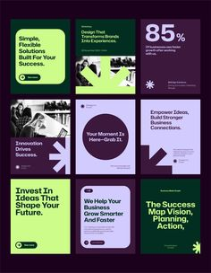

# Nine plum, lime and lavender business posts with giant arrows and stat cards

**Discipline:** print-social ·  · **Design style:** Corporate & Clean-Tech
**Tags:** business, plum, lime, lavender, arrows, stats, templates, grid

## What it is
A 3x3 grid of square posts in dark plum, lime green and lavender with bold sans headlines, big geometric arrow shapes, a large '85%' stat, black-and-white photos and small pill buttons.

## What it means
Modern and confident; lime pops strongly against plum.

## Techniques
- Use large geometric arrows as the main graphic.
- Alternate plum, lime and lavender fills.
- Convert photos to greyscale to sit in the palette.
- Add a stat card among text cards.

## Best for
- Business and consulting social sets
- Growth and strategy content
- Template packs

## Vocabulary
- **Arrow graphic** — A large arrow shape used as a hero element.
- **Palette trio** — Three colours used across a set.
- **Greyscale photo** — A black-and-white image.
- **Stat card** — A card featuring one big number.
