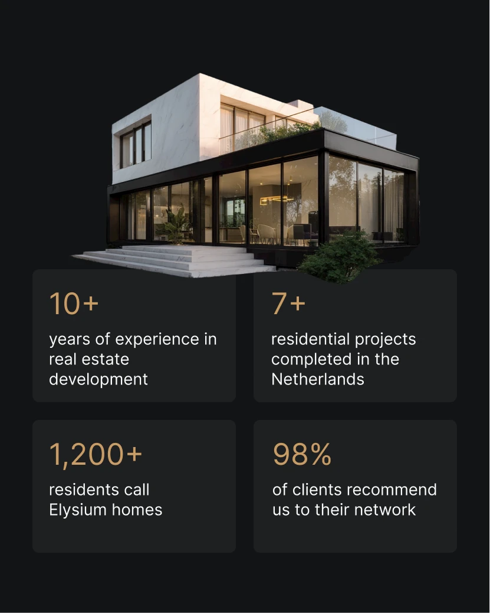

# Dark charcoal post with a glass-and-marble villa cutout above four stat tiles in gold numerals

**Discipline:** print-social · **Design type:** Social ad
**Tags:** real-estate, dark, gold, stat-tiles, cutout, luxury, villa, portrait

## What it is
A charcoal portrait with a cutout of a modern two-storey villa with marble and glass over four rounded dark tiles showing gold numerals (10+, 7+, 1,200+, 98%) with light captions.

## What it means
Quiet and premium; gold numerals on dark tiles read as credentials.

## Techniques
- Cut out a building so it sits above the tiles.
- Use gold light numerals.
- Arrange stats in a 2x2 grid of tiles.
- Keep everything dark and warm.

## Best for
- Developer credential posts
- Luxury stats layouts
- Dark gold real-estate

## Vocabulary
- **Building cutout** — A building photo with its background removed.
- **Gold numeral** — A number in muted gold.
- **Stat tile grid** — A 2x2 grid of stat cards.
- **Dark tile** — A slightly lighter panel on a dark background.
