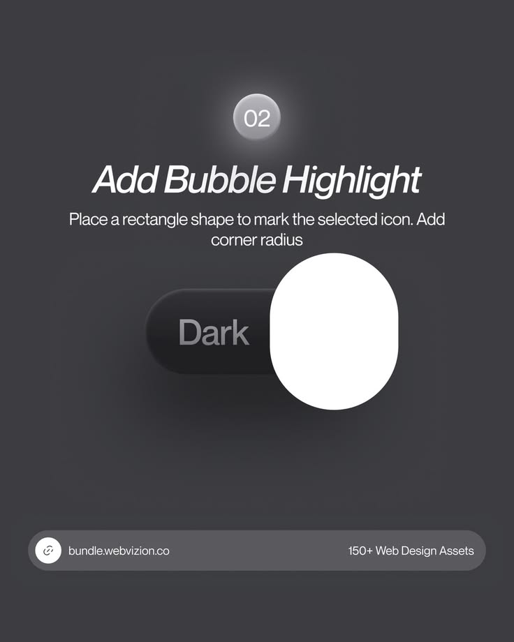

# Dark Toggle Bubble Highlight Tutorial

**Discipline:** print-social ·  · **Design style:** Dark & Neon
**Tags:** tutorial, dark, toggle, step, neumorphic, grey, how-to

## What it is
A charcoal tutorial post, step 02 of a UI recipe: a glowing number bubble, italic headline, instruction text and a dark pill toggle with a large white oval highlight, and a link bar at the foot.

## What it means
A tactile dark UI with one white shape shows the exact technique being taught. Muted greys make the white highlight the star.

## Techniques
- Numbered glowing bubble as step marker
- Italic sans headline for a dynamic feel
- Oversized enlarged component as the demonstration
- Soft inner shadows for a tactile surface
- Rounded link bar with contact and offer text

## Best for
- UI design tutorials
- Asset-bundle promotion
- Step-by-step carousels

## Vocabulary
- **Bubble highlight** — A rounded shape marking the selected item in a switch.
- **Step bubble** — A numbered circle indicating a step.
- **Soft UI** — Interface with subtle raised and inset shadows.
