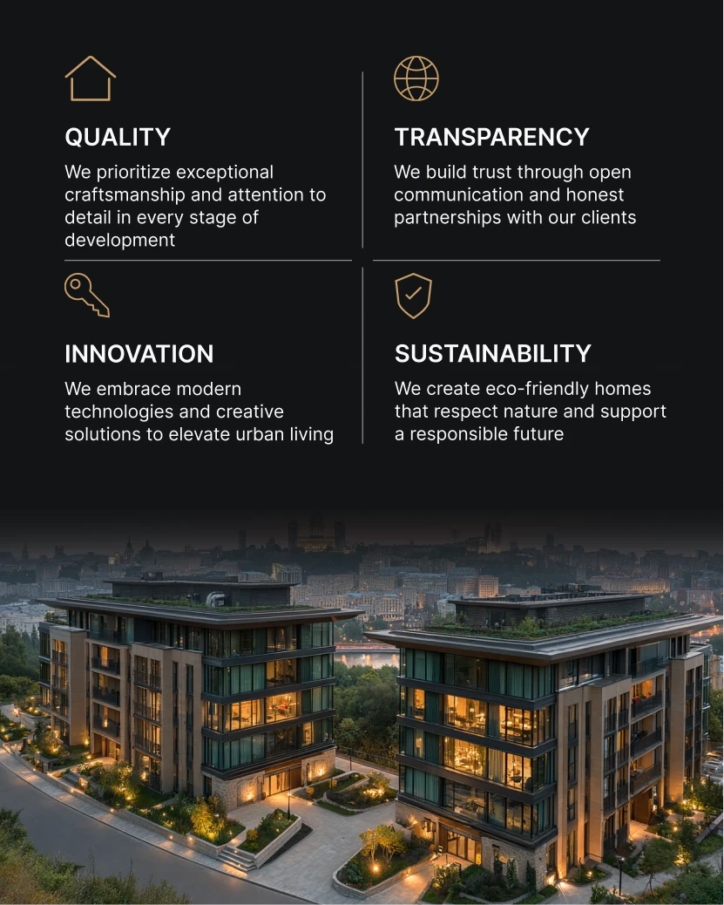

# Four company values with gold line icons above a lit dusk apartment complex

**Discipline:** print-social ·  · **Design style:** Dark & Neon
**Tags:** real-estate, values, black, gold, line-icons, dusk, photo-fade, grid

## What it is
A black portrait post with a 2x2 grid of values (Quality, Transparency, Innovation, Sustainability), each with a gold outline icon, bold caps title and short white text separated by hairlines, fading into a photo of two lit green-roofed apartment buildings at dusk.

## What it means
Premium and orderly; gold on black feels upscale, and the photo grounds the claims.

## Techniques
- Use thin gold line icons on black.
- Split values into a 2x2 grid with hairline dividers.
- Fade the top of a photo into the black.
- Keep text white and light.

## Best for
- Real-estate developers
- Corporate values posts
- Luxury dark layouts

## Vocabulary
- **Line icon** — An icon drawn with a thin outline.
- **Hairline divider** — A thin rule separating items.
- **Photo fade** — An image dissolving into a solid colour.
- **Value grid** — A 2x2 layout of principles.
