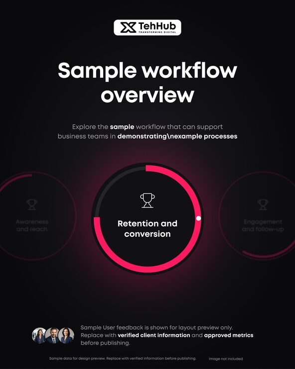

# Dark 'Sample workflow overview' post with a pink progress ring carousel of stages

**Discipline:** print-social · **Design type:** Social educational post · **Design style:** Dark & Neon
**Tags:** workflow, process, dark, pink, progress-ring, saas, carousel

## What it is
A near-black portrait post with a white logo badge, a large 'Sample workflow overview' title, and a central ring gauge with a hot-pink progress stroke around 'Retention and conversion', flanked by faded rings for 'Awareness and reach' and 'Engagement and follow-up', plus avatar social proof at the bottom.

## What it means
Focused and product-like; the faded neighbours imply a sequence, like a UI carousel frozen mid-swipe.

## Techniques
- Show one step in focus with neighbours faded to the sides.
- Use a progress ring to show stage completion.
- Add a soft colour glow behind the focal element.
- Close with a row of avatars as social proof.

## Best for
- SaaS funnel explainers
- Marketing process posts
- Onboarding steps

## Vocabulary
- **Progress ring** — A circular stroke showing a percentage.
- **Focus carousel** — A row where the centre item is sharp and neighbours faded.
