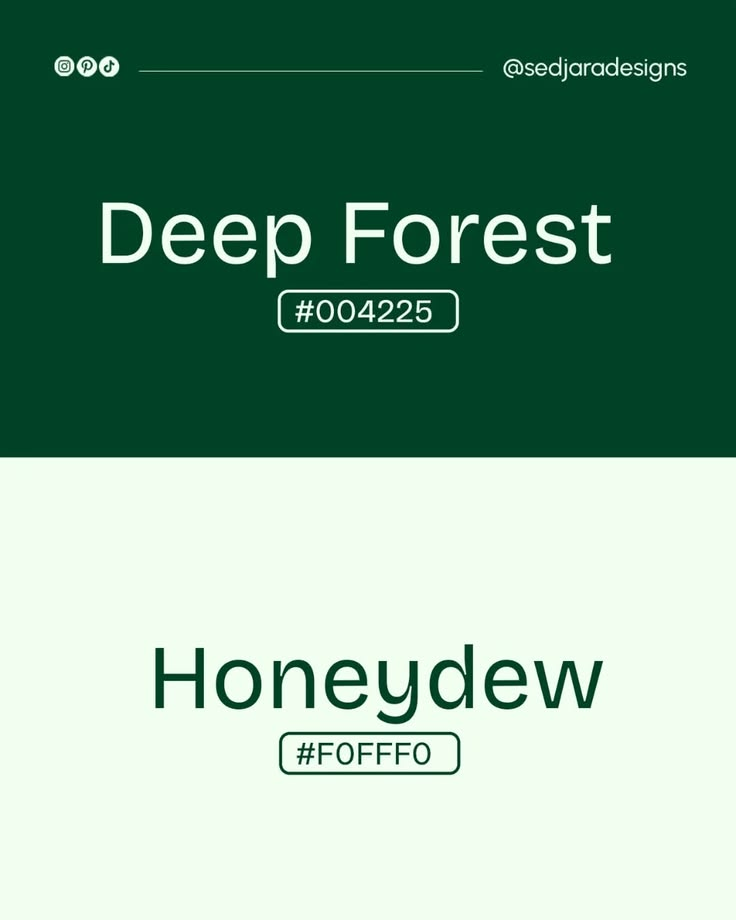

# Deep Forest and Honeydew Colour Post

**Discipline:** print-social · **Design type:** Social educational post
**Tags:** colour, green, mint, split, hex, minimal, palette

## What it is
A portrait post split into a deep forest green upper half with pale text 'Deep Forest #004225' and a honeydew mint lower half with green text 'Honeydew #F0FFF0', each hex code in an outlined pill and a social handle strip at the top.

## What it means
Each colour is the other's text colour, and the natural names evoke calm and freshness.

## Techniques
- Swap foreground and background between halves
- Evocative colour names
- Outlined hex pill
- Handle header line with icons
- Only two colours

## Best for
- Colour palette posts
- Minimal two-colour layouts
- Green brand inspiration

## Vocabulary
- **Colour pair** — Two colours chosen to work together.
- **Inverted halves** — Two areas where foreground and background swap.
- **Hex pill** — An outlined label with a colour code.
