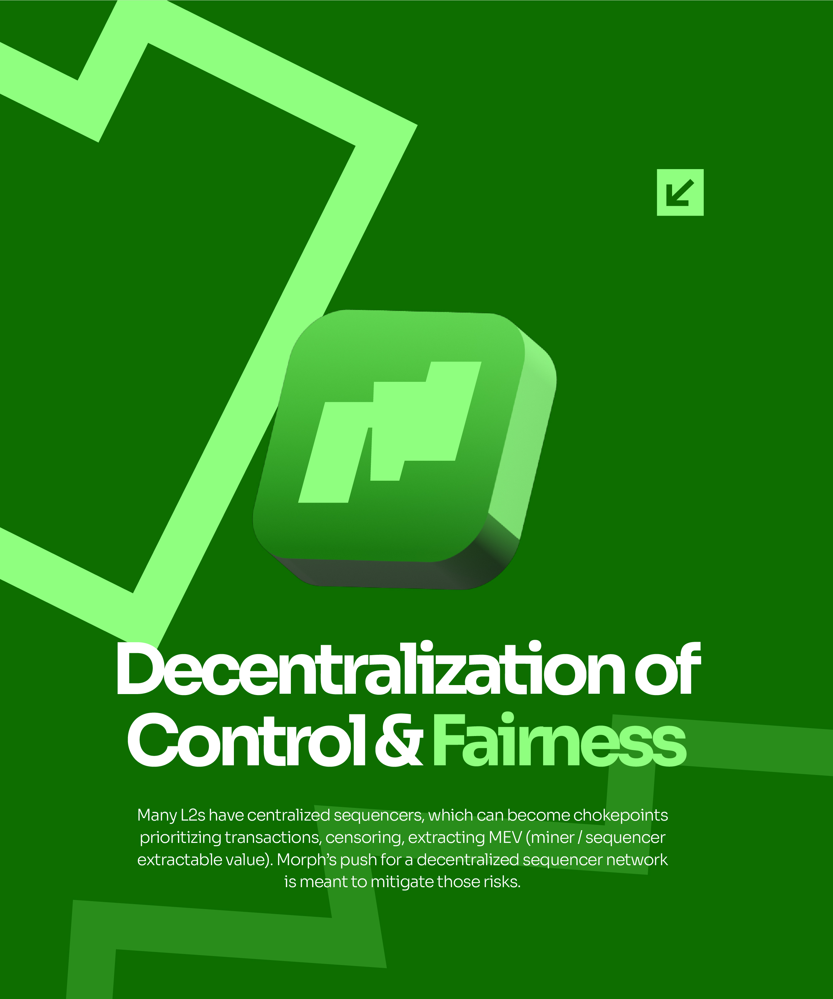

# Deep Green 3D Logo Tile Slide

**Discipline:** print-social ·  · **Design style:** 3D & Surreal
**Tags:** carousel, deep-green, 3d, logo-tile, zigzag, white-type, blockchain

## What it is
A deep green portrait slide with mint zigzag bands, a glossy 3D rounded-square tile holding the brand mark in the centre, a large white heading 'Decentralization of Control & Fairness' with 'Fairness' in mint, a centred paragraph and a small arrow tile at the top right.

## What it means
A single rendered logo tile gives a solid focal point in a flat graphic system, and white on deep green feels serious.

## Techniques
- 3D extruded logo tile as the hero
- Mint zigzag stripes behind
- White heading with one mint word
- Centred paragraph below
- Small arrow tile as a slide cue

## Best for
- Blockchain and fintech carousels
- Dark green brand systems
- 3D logo highlights

## Vocabulary
- **Extruded tile** — A rounded square given 3D thickness.
- **Accent word** — A word in a second colour within a heading.
- **Slide cue** — A small icon hinting at the next slide.
