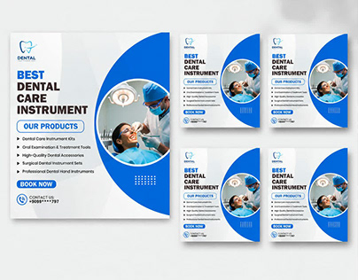

# Blue-and-white dental promo set with a large circular photo, bullet list and Book Now pill

**Discipline:** print-social ·  · **Design style:** Corporate & Clean-Tech
**Tags:** dental, medical, blue, white, circle-photo, product-list, templates, corporate

## What it is
A large white post and four smaller copies for dental instruments: a heavy blue-and-black headline, a bulleted product list, a blue 'Our products' pill, a big circular photo of a dentist and patient framed by a blue curve, a blue Book Now pill and contact details.

## What it means
Clean and clinical; a big circle photo and blue curve are a familiar trustworthy pattern.

## Techniques
- Crop the hero photo in a big circle over a blue arc.
- Use bold two-tone headlines.
- List products with bullets.
- Repeat the layout across sizes.

## Best for
- Medical and dental product ads
- Simple corporate promo posts
- Template variations

## Vocabulary
- **Circle crop** — A photo masked to a circle.
- **Blue arc** — A curved blue band framing content.
- **Bullet list** — Short items marked with dots.
- **Book-now pill** — A capsule call-to-action.
