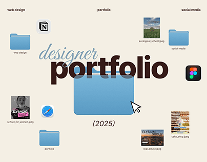

# Designer portfolio cover as a desktop with folders

**Discipline:** print-social · **Design type:** Presentation slides
**Tags:** portfolio, desktop-metaphor, serif-script, cream, folders, file-icons, cursor

## What it is
A cream cover with an oversized script and serif title 'designer portfolio (2025)' over a big blue macOS-style folder and a cursor. Small folders and file thumbnails of social and web projects, plus app icons, float around.

## What it means
Familiar, witty and organised; it makes browsing a portfolio feel like opening files.

## Techniques
- Recreate a desktop with folders and file names to present categories.
- Overlap a script word on a heavy serif word for contrast.
- Scatter project thumbnails as tiny file previews.
- Keep a soft cream background with blue folders as the only saturated colour.

## Best for
- Portfolio covers and agenda slides
- Creative freelancers
- Presentations that map out sections

## Vocabulary
- **Desktop metaphor** — Interface icons used as illustration.
- **Script overlay** — A flowing script word laid over bold type.
- **File thumbnail** — A tiny image labelled like a file.
- **Cover slide** — The opening slide of a deck.
