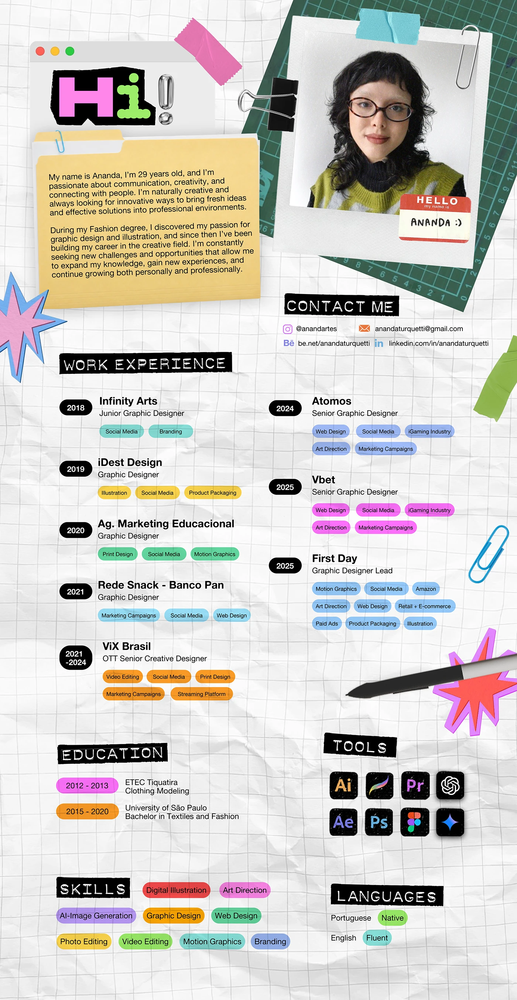

# Long resume on crumpled graph paper with 'Hi!' letters, taped polaroid, folder bio, black label headings and coloured skill tags

**Discipline:** print-social ·  · **Design style:** Playful & Illustrated
**Tags:** resume, collage, graph-paper, stickers, tape, colour-tags, black-labels, pink

## What it is
A tall crumpled grid-paper page with a window bar and pink and lime 'Hi!' letters with a chrome exclamation mark, a manila folder holding the bio, a taped polaroid of the designer on a green cutting mat with a hello sticker, black label headings in monospace (Contact me, Work experience, Education, Tools, Skills, Languages), dated black pills, coloured tag chips per job, app icons and doodle stickers.

## What it means
Playful and warm; craft objects make a CV feel handmade and memorable.

## Techniques
- Use black tape-label headings.
- Colour-code tag chips by job.
- Attach photos with tape and clips.
- Add star stickers and a stylus.

## Best for
- Creative resumes
- Craft-style portfolios
- Long informational pages

## Vocabulary
- **Label heading** — A heading on a black label strip.
- **Tag chip** — A small coloured capsule naming a skill.
- **Date pill** — A black capsule with a year.
- **Desk collage** — A layout made from stationery objects.
