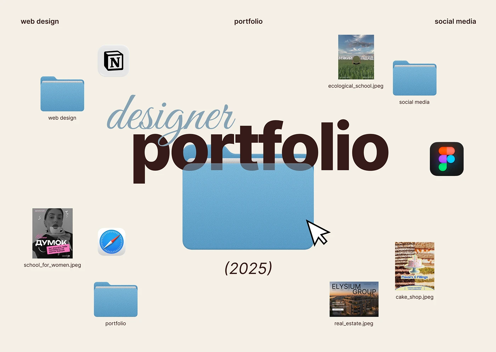

# Designer portfolio cover with script overlaying heavy sans and a huge blue folder

**Discipline:** print-social ·  · **Design style:** Warm & Organic
**Tags:** portfolio, cover, cream, folders, script-overlay, desktop-metaphor, brown, blue

## What it is
A cream slide with a large heavy chocolate 'portfolio' word overlapped by a blue script 'designer' and a translucent big blue folder with a cursor, italic '(2025)' beneath, and scattered desktop items: folders, Notion and Figma icons, Safari icon and file thumbnails of the designer's projects.

## What it means
Friendly, clever and orderly; the folder metaphor doubles as a table of contents.

## Techniques
- Overlap a script word on a bold sans word for depth.
- Let the folder sit in front of part of the letters, semi-transparent.
- Use project thumbnails with filenames as a contents list.
- Sprinkle app icons as personality.

## Best for
- Portfolio covers
- Designer decks with sections
- Personal branding

## Vocabulary
- **Script overlap** — A script word laid over a heavier word.
- **Translucent object** — An item shown partly see-through.
- **File thumbnail** — A small image labelled like a file.
- **Contents map** — A layout that also acts as a table of contents.
