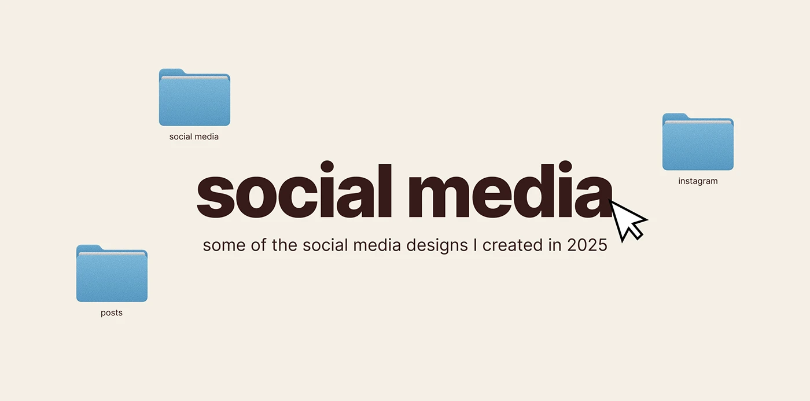

# Cream title slide with huge heavy 'social media', cursor and three blue folders

**Discipline:** print-social ·  · **Design style:** Warm & Organic
**Tags:** title-slide, cream, brown, folders, cursor, heavy-sans, desktop-metaphor, portfolio

## What it is
A cream slide with a giant chocolate heavy sans 'social media', a pixel-outlined cursor at its end, a small subline, and three blue folders labelled 'social media', 'instagram' and 'posts' scattered around.

## What it means
Simple and friendly; folders turn a title into a computer desktop.

## Techniques
- Set one huge heavy word as the title.
- Scatter labelled folders around it.
- Add a cursor as a call to click.
- Use only cream, brown and blue.

## Best for
- Portfolio section dividers
- Desktop-themed presentations
- Title slides

## Vocabulary
- **Desktop scatter** — Icons placed randomly like a desktop.
- **Heavy sans title** — A very bold sans-serif headline.
- **Cursor accent** — A pointer used as an ornament.
- **Section divider** — A slide introducing a new section.
