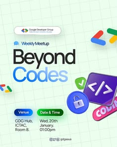

# Developer meetup flyer on mint grid paper with code and lock stickers

**Discipline:** print-social ·  · **Design style:** Playful & Illustrated
**Tags:** event, meetup, mint, grid-paper, stickers, pills, developer, weekly

## What it is
A mint-green square-ruled background with a white logo pill, a small 'Weekly Meetup' tag, giant two-line title 'Beyond Codes' with 'Codes' in blue, blue and green pills for Venue and Date & Time, and 3D-style stickers (code tag, lock, coloured chevrons) at the right edge.

## What it means
Friendly and techy; the notebook grid says 'learning' and the stickers add playfulness.

## Techniques
- Use graph paper as the background to signal coding and notes.
- Split the title into black and brand-blue words.
- Turn logistics into coloured pills.
- Attach 3D icons partly cropped at the edge.

## Best for
- Developer and student community events
- Workshop and webinar flyers
- Tech club branding

## Vocabulary
- **Grid-paper background** — A ruled square pattern like a notebook.
- **Info pills** — Rounded labels for venue and date.
- **Edge sticker** — An icon cropped by the frame.
- **Two-tone title** — A headline with one word coloured.
