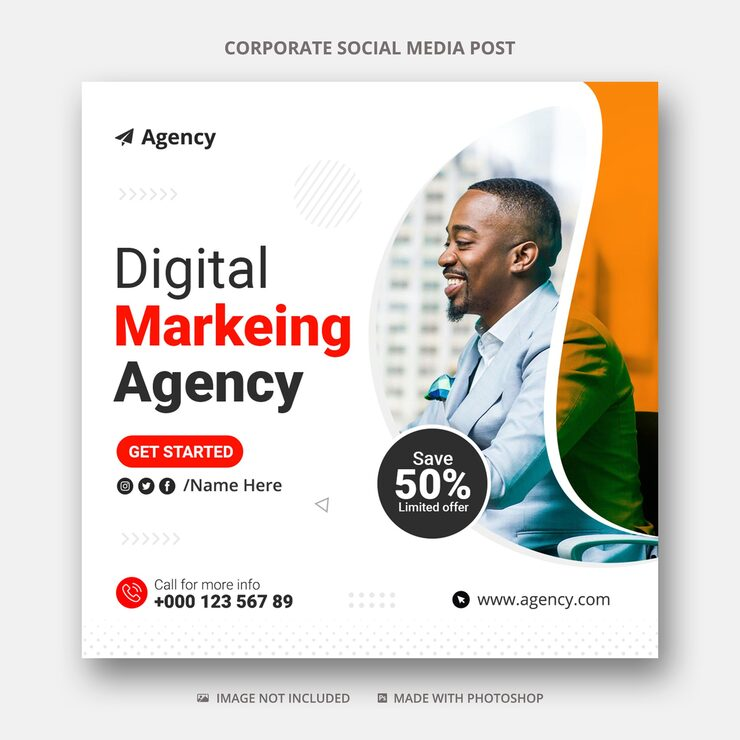

# 'Digital Marketing Agency' post with a blob-shaped photo and black 'Save 50%' circle badge

**Discipline:** print-social · **Design type:** Social ad · **Design style:** Corporate & Clean-Tech
**Tags:** agency, red, orange, blob, discount, ad

## What it is
A square white post with a black, red and black headline, red 'Get started' pill, social handle row, chevron rows, a photo of a smiling man in a light suit masked into a tall organic blob with an orange edge, and a black circle badge 'Save 50% Limited offer'.

## What it means
Clean and sales-driven; the round badge pops against the flowing photo shape.

## Techniques
- Mask the photo into an organic blob with a colour edge.
- Overlap a circle badge onto the photo edge.
- Use chevron rows as directional texture.

## Best for
- Agency offers
- Discount promos
- Service ads

## Vocabulary
- **Blob mask** — An organic curved shape used to crop a photo.
- **Offer badge** — A circle highlighting a discount.
