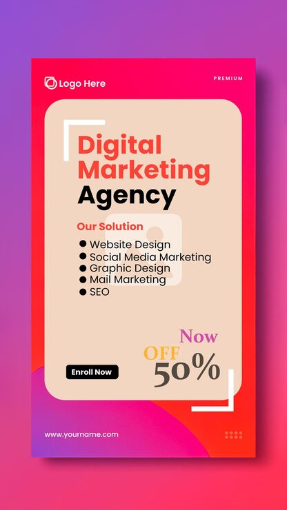

# 'Digital Marketing Agency' story with a pink-purple gradient, cream rounded card and bold '50% off' corner

**Discipline:** print-social · **Design type:** Social ad · **Design style:** Gradient & Aurora
**Tags:** agency, story, pink, purple, gradient, offer

## What it is
A vertical pink-to-purple gradient story with a rounded cream card holding a bold two-tone 'Digital Marketing Agency' headline, a bulleted service list (Website Design, Social Media Marketing, Graphic Design, Mail Marketing, SEO), a black 'Enroll Now' button, and a large 'Now OFF 50%' callout in mixed colours and weights.

## What it means
Bold and legible; a rounded cream card floating over a vivid gradient keeps a busy offer story easy to read.

## Techniques
- Float a rounded content card over a vivid gradient background.
- Mix multiple colours and weights within one discount callout.
- Bracket the card with corner brackets for a 'premium' framing detail.

## Best for
- Marketing agency promotions
- Instagram story offers
- Gradient-background ads

## Vocabulary
- **Content card** — A distinct panel holding the main message, floated over a background.
- **Corner bracket** — A small L-shaped mark framing a corner, borrowed from camera viewfinders.
