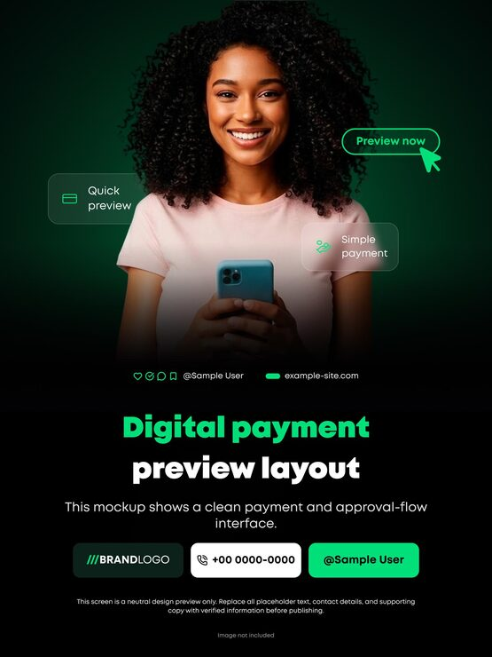

# 'Digital payment preview layout' post with a smiling woman and floating glass UI chips

**Discipline:** print-social · **Design type:** Product UI promo card · **Design style:** Glassmorphism
**Tags:** fintech, payment, green, glass, portrait, dark

## What it is
A portrait post with a smiling curly-haired woman holding a phone on a dark green gradient, three floating frosted-glass chips ('Quick preview', 'Simple payment', and an outlined 'Preview now' button with a cursor), a green and white headline and a row of three contact buttons (brand logo, phone, handle).

## What it means
Human and trustworthy; glass UI chips connect a real person to the product's features.

## Techniques
- Float glass UI chips around a portrait.
- Add a cursor on a button to imply action.
- Close with a row of pill contact buttons.
- Glow a dark green gradient behind the subject.

## Best for
- Payment apps
- Fintech ads
- App feature promos

## Vocabulary
- **UI chip** — A small floating interface element.
- **Glassmorphism** — Frosted translucent panels with blur.
