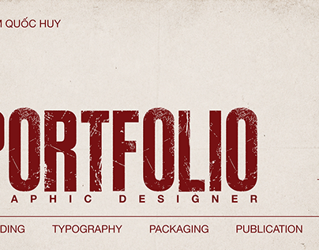

# Cropped portfolio cover with giant distressed red condensed letters on cream paper

**Discipline:** print-social ·  · **Design style:** Warm & Organic
**Tags:** portfolio, cover, red, cream, distressed, condensed-caps, cropped, grunge

## What it is
A cream paper-textured cover with a tiny red name at the top left, enormous distressed dark-red condensed letters spelling PORTFOLIO cropped at the left, a wide-tracked red 'GRAPHIC DESIGNER' under it and category words along a rule at the bottom.

## What it means
Raw and confident; distressed letters look printed and worn.

## Techniques
- Set giant condensed letters cropped by the frame.
- Distress with worn texture.
- Add a tracked caps subtitle.
- Use a rule with category list.

## Best for
- Graphic design portfolio covers
- Grunge and print aesthetics
- Red on cream layouts

## Vocabulary
- **Distressed type** — Letters with worn texture.
- **Cropped title** — A title cut by the frame.
- **Tracked subtitle** — Widely spaced small caps.
- **Category rule** — A line with service words beneath.
