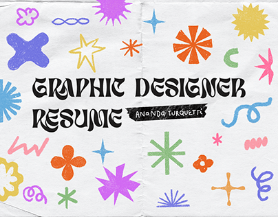

# Resume cover with hand-drawn colourful shapes on crumpled white paper

**Discipline:** print-social ·  · **Design style:** Playful & Illustrated
**Tags:** resume, doodles, crumpled-paper, multicolour, shapes, hand-drawn, cover

## What it is
A crumpled white paper spread with a heavy hand-lettered 'GRAPHIC DESIGNER RESUME' in dark ink in the middle and a scatter of colourful hand-drawn stars, bursts, squiggles, flowers and asterisks in blue, purple, orange, pink, yellow and green. A name tape strip overlaps the title.

## What it means
Warm, playful and human; imperfect marks feel drawn by hand.

## Techniques
- Scatter a vocabulary of hand-drawn shapes around a central title.
- Use crumpled paper texture as the ground.
- Keep each shape in one flat colour with a crayon-like edge.
- Attach a black tape strip label with handwriting.

## Best for
- Creative CV and portfolio covers
- Kids and craft brands
- Playful decks needing texture

## Vocabulary
- **Doodle vocabulary** — A set of hand-drawn marks used as decoration.
- **Crumpled paper texture** — A photo of wrinkled paper used as a background.
- **Crayon edge** — A slightly rough outline like wax crayon.
- **Label tape** — A tape strip carrying a name.
