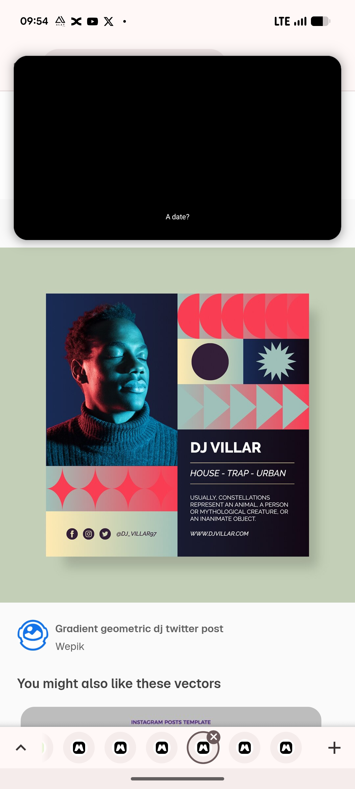

# DJ Villar Geometric Mosaic Post (Full View)

**Discipline:** print-social · **Design type:** Social promo post
**Tags:** dj, duotone, portrait, geometric, gradient, sage-backdrop, template, mosaic

## What it is
The full view of the DJ post on a sage-green backdrop with a soft drop shadow: a duotone portrait, a coral, teal and cream gradient mosaic of discs, arrows and a starburst, and a navy text panel with a name, genres, a line of text and a URL.

## What it means
Seeing the complete layout shows how the quiet sage backdrop makes the coral and teal mosaic pop.

## Techniques
- Sage backdrop to present the post
- Portrait and mosaic sharing one colour range
- Panel with thin rules framing the genre line
- Socials at the lower left on cream
- Drop shadow for presentation depth

## Best for
- Music promotion templates
- Geometric gradient posts
- Presentation of social templates

## Vocabulary
- **Presentation backdrop** — A calm colour placed behind a template preview.
- **Colour range** — The set of hues shared by photo and graphics.
- **Genre line** — Italic text listing music styles.
