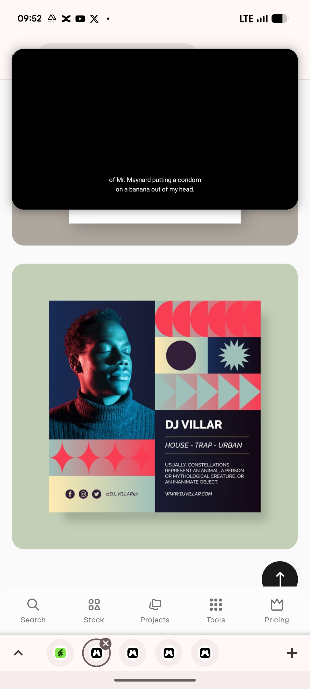

# DJ Portrait with Gradient Geometric Mosaic

**Discipline:** print-social · **Design type:** Social promo post
**Tags:** dj, duotone, portrait, geometric, gradient, coral, teal, mosaic

## What it is
A square post for a DJ with a red-and-teal duotone portrait of a man in a roll-neck on navy at the left, a mosaic of coral half-discs, a dark circle, a teal starburst and cream-to-teal gradient arrows and diamonds at the right, and a dark panel with 'DJ VILLAR', genres in italic, a short line and a website, plus social icons on a cream base.

## What it means
A mosaic of simple shapes in gradient fills echoes music rhythm, and the duotone portrait ties into the palette.

## Techniques
- Red and teal duotone lighting on the portrait
- Mosaic of geometric tiles with gradient fills
- Repeating half-discs, arrows and diamonds as rhythm
- Dark text panel with rules around the genres
- Social icons and handle on a light base

## Best for
- Music and DJ promo posts
- Geometric mosaic layouts
- Duotone photo posts

## Vocabulary
- **Duotone lighting** — Lighting a subject with two contrasting colours.
- **Tile mosaic** — A grid of tiles each holding a simple graphic.
- **Gradient fill** — A shape filled with a smooth colour blend.
