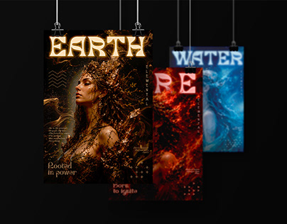

# Earth, Water and Fire element posters with ornate display type hanging on binder clips

**Discipline:** print-social · **Design type:** Poster · **Design style:** Photographic & Cinematic
**Tags:** posters, elements, fantasy, gold, display-type, series

## What it is
Three portrait posters clipped to strings on black: 'EARTH' with a woman crowned in gold roots and a gold ornamental display face, 'WATER' in icy blue, 'FIRE' in red, each with small vertical text and a tagline like 'Rooted in power'.

## What it means
Mythic and dramatic; each element gets its own colour world within one typographic system.

## Techniques
- Build a series by swapping colour per theme.
- Use an ornamental display typeface for fantasy.
- Hang posters on clips for a gallery mockup.

## Best for
- Poster series
- Fantasy or game art
- Themed campaigns

## Vocabulary
- **Series system** — Shared layout rules across a set of designs.
- **Display typeface** — A decorative font meant for large sizes.
