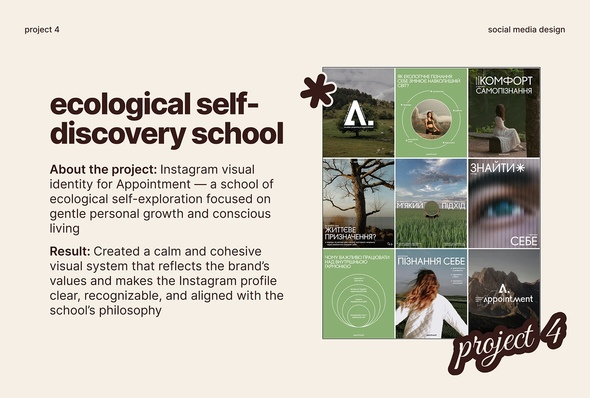

# Cream 'ecological self-discovery school' slide with a nature-photo and sage feed grid and an asterisk sticker

**Discipline:** print-social ·  · **Design style:** Warm & Organic
**Tags:** case-study, social-media, cream, brown, sage-green, feed-grid, asterisk-sticker, script-sticker

## What it is
A cream slide with a heavy chocolate title 'ecological self-discovery school', About and Result paragraphs, a boxed 3x3 feed of muted nature photos and sage green diagrams and a chunky outlined asterisk sticker and script 'project 4' sticker.

## What it means
Calm and natural; sage and photography match the school's philosophy.

## Techniques
- Show a nature-toned feed grid.
- Add asterisk and script stickers.
- Use bold lead-ins.
- Keep cream and brown.

## Best for
- Wellness social case studies
- Nature-toned identities
- Portfolio decks

## Vocabulary
- **Nature feed** — A feed of muted landscape photos.
- **Asterisk sticker** — A chunky outlined star-like shape.
- **Sage diagram post** — A green post with a concentric-circle diagram.
- **Project sticker** — A script label numbering the project.
