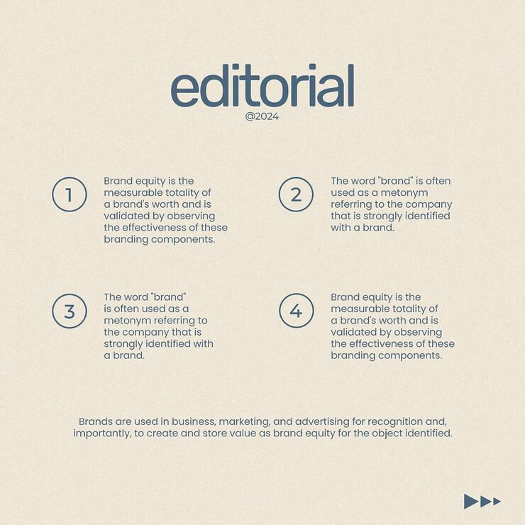

# 'editorial' brand-equity carousel slide with four numbered circle callouts on textured cream paper

**Discipline:** print-social · **Design type:** Social educational post · **Design style:** Editorial
**Tags:** editorial, typography, cream, numbered, paper-texture, educational

## What it is
A textured cream square post with a huge lowercase 'editorial' wordmark and '@2024' date, four numbered circle callouts (1–4) each paired with a short paragraph about brand equity, and a closing summary line at the bottom with a small triple-arrow mark.

## What it means
Calm and credible; a textured paper background and restrained navy type make a marketing lesson feel like a printed essay.

## Techniques
- Use a large lowercase wordmark as a simple visual anchor.
- Number educational points with outlined circles rather than solid badges.
- Add a subtle paper grain texture for warmth.

## Best for
- Marketing education content
- Brand strategy carousels
- Editorial-style Instagram posts

## Vocabulary
- **Paper grain** — A fine textured overlay mimicking real paper.
- **Outlined circle badge** — A number marker drawn as a stroke only, not filled.
