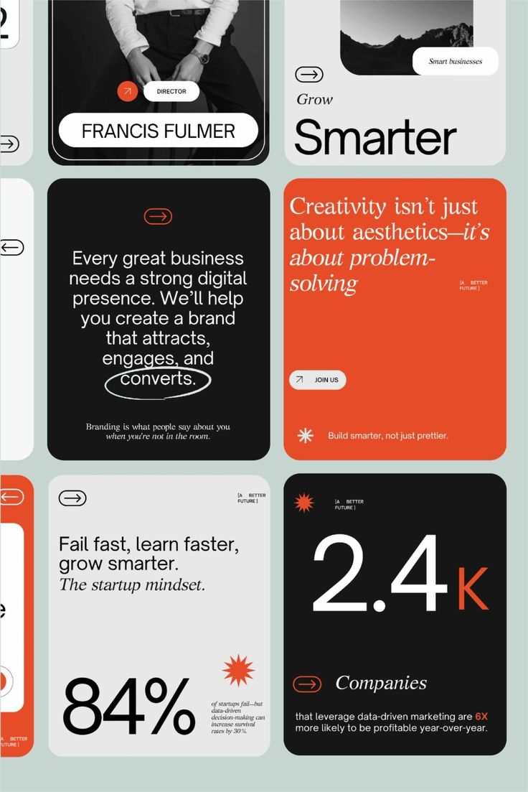

# Orange, black and grey editorial cards with serif italics and huge stats

**Discipline:** print-social · **Design type:** Social template pack
**Tags:** editorial, cards, orange, black, grey, serif-italic, big-numbers, arrows

## What it is
A grid of rounded cards in black, orange and pale grey: a director portrait with name pill, 'Grow Smarter' with an arrow chip, a manifesto paragraph with a hand-drawn circle around 'converts', an orange card in italic serif, '84%' with a starburst, and '2.4K' with an orange K.

## What it means
Modern, editorial and confident; contrasting sans and italic serif give agency-level polish.

## Techniques
- Mix a clean grotesque with italic serif in one card set.
- Use huge stat numerals with a tiny explanatory caption.
- Put arrow-in-pill icons as navigation chips.
- Circle a key word with a hand-drawn ellipse.
- Limit the palette to orange, black and grey.

## Best for
- Agency and studio social decks
- Thought-leadership carousels
- Brand-voice templates

## Vocabulary
- **Arrow chip** — A small pill containing an arrow.
- **Italic serif accent** — Italic serif type used to add elegance.
- **Hand-drawn ellipse** — A scribbled oval around a word.
- **Stat card** — A card built around one large number.
