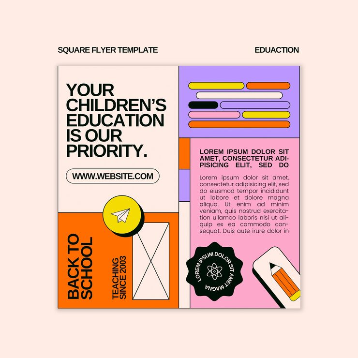

# 'Your Children's Education Is Our Priority' flyer split into orange, purple and pink quadrants with an atom badge

**Discipline:** print-social · **Design type:** Social ad · **Design style:** Neo-Brutalist
**Tags:** education, back-to-school, orange, purple, quadrant, badge

## What it is
A square flyer divided into four quadrants (cream, lavender, orange, pink) with a bold black headline 'Your Children's Education Is Our Priority', a yellow paper-plane badge, an 'X' motif box, a black wavy 'Back to School' tag, a scalloped atom-icon seal, colour-coded text bars and a pencil illustration.

## What it means
Bold and organised; splitting the flyer into flat colour quadrants keeps a lot of school-related content easy to scan at a glance.

## Techniques
- Split a layout into distinct flat-colour quadrants.
- Use a scalloped seal badge for a trust or credential mark.
- Mix bar-style filler graphics with real body copy for texture.

## Best for
- School and education marketing
- Back-to-school campaigns
- Bold quadrant layouts

## Vocabulary
- **Quadrant layout** — A design split into four distinct colour sections.
- **Scalloped seal** — A badge shape with a wavy, stamp-like edge.
