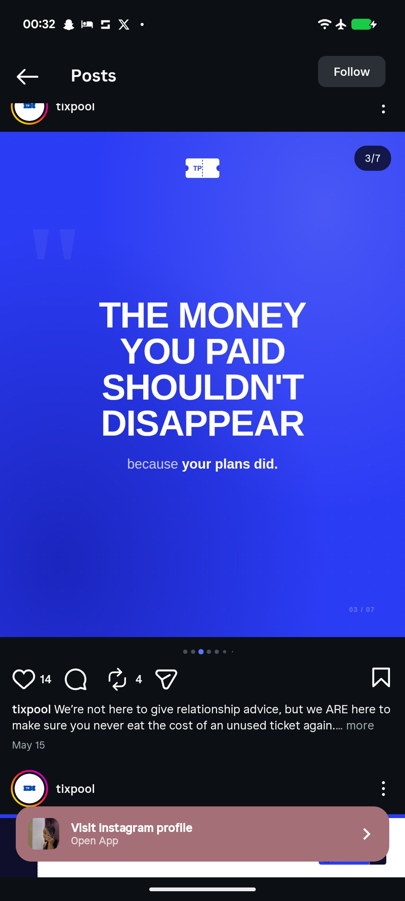

# Electric Blue Money Shouldn't Disappear Slide

**Discipline:** print-social ·  · **Design style:** Minimalist
**Tags:** carousel, electric-blue, white-type, quote-mark, statement, centered, ticket-logo

## What it is
A full electric blue slide with a small white ticket logo, a faint giant quotation mark, a huge white heavy headline 'THE MONEY YOU PAID SHOULDN'T DISAPPEAR' and a lighter line 'because your plans did.' with a bold ending, and a small counter.

## What it means
A solid saturated field and heavy centred type make the statement feel like a manifesto, and a light sub-line adds a human turn.

## Techniques
- Solid electric blue field
- Very heavy centred caps headline
- Light-to-bold sub-line for a twist
- Faint oversized quote mark as texture
- White ticket logo at the top centre

## Best for
- Manifesto and statement slides
- Blue brand carousels
- Bold text posts

## Vocabulary
- **Statement slide** — A slide with one big claim.
- **Watermark quote mark** — A huge faint quotation mark used as background.
- **Light-to-bold turn** — A sentence that shifts weight to emphasise the end.
