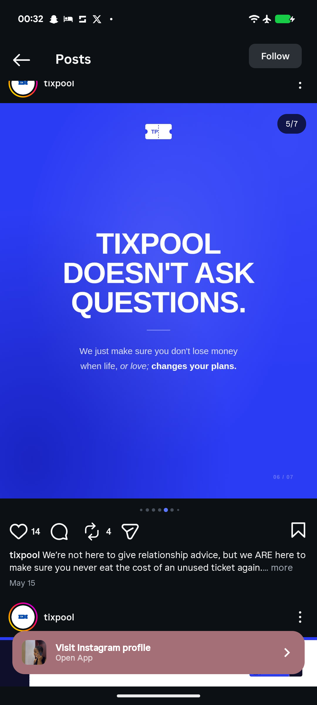

# Doesn't Ask Questions Blue Statement Slide

**Discipline:** print-social · **Design type:** Social carousel
**Tags:** carousel, electric-blue, white-type, statement, divider-line, italic, ticket-logo

## What it is
An electric blue slide with a ticket logo, a giant white heavy centred headline 'TIXPOOL DOESN'T ASK QUESTIONS.', a short rule and a light body line with an italic phrase and a bold ending.

## What it means
A brand name inside a bold claim gives a slide its own voice, and a hairline rule separates the claim from the reason.

## Techniques
- Giant centred caps headline
- Short hairline rule as a divider
- Light body with italic and bold mixed
- Solid blue backdrop
- Counter in the lower right

## Best for
- Brand statement slides
- Blue carousel systems
- Conversational copy

## Vocabulary
- **Divider rule** — A short line separating a headline from its supporting text.
- **Mixed emphasis** — Using italic and bold within a sentence.
- **Brand claim** — A bold sentence describing what the brand does or does not do.
