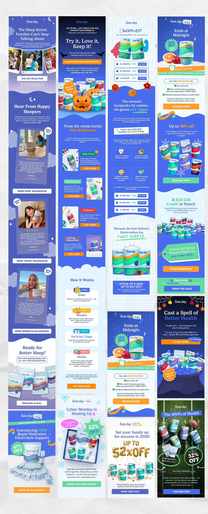

# Royal-blue email newsletters for a vitamin brand across back-to-school, Halloween and sale themes

**Discipline:** print-social ·  · **Design style:** Photographic & Cinematic
**Tags:** email, newsletter, royal-blue, seasonal, halloween, black-friday, product-photography, long-scroll

## What it is
Twelve tall email layouts side by side, mostly cobalt and periwinkle. They combine product tub photography, cloud or bat decorations, round discount badges, orange CTA buttons, review cards with photos, step lists and a green football-field variant.

## What it means
Cheerful and promotional; a fixed blue base with seasonal props keeps every send recognisable.

## Techniques
- Keep a constant blue base and swap seasonal decorations.
- Use bright orange buttons for every call to action.
- Present offers as round starburst badges.
- Combine customer review cards with product hero shots.
- Section emails with wavy dividers.

## Best for
- Ecommerce email design
- Seasonal campaign systems
- Supplement and family brands

## Vocabulary
- **Seasonal skin** — Temporary decorative theme on a fixed system.
- **Discount badge** — A round or starburst label showing a percentage off.
- **Review card** — A card with a customer photo, stars and quote.
- **Wavy divider** — A curved edge between sections.
