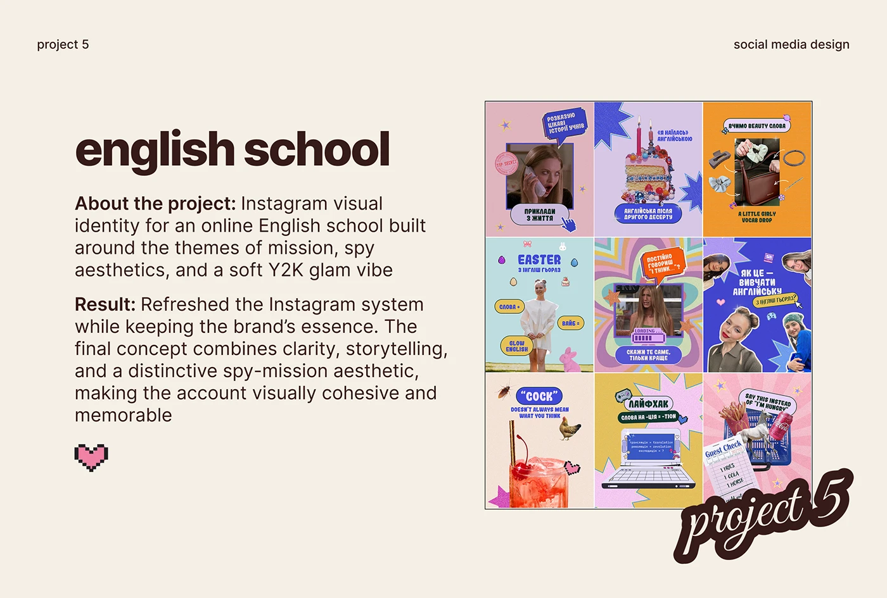

# Project slide for a Y2K spy-themed English school feed with heart pixel icon

**Discipline:** print-social · **Design type:** Presentation slides
**Tags:** case-study, social-media, cream, brown-type, feed-grid, y2k, script-sticker, pixel-heart

## What it is
A cream slide with tiny top labels, a huge heavy brown title 'english school', paragraphs with bold lead-ins about a spy-mission Y2K vibe, a pixel heart, and a boxed 3x3 feed grid of colourful posts with a script 'project 5' sticker over its corner.

## What it means
Warm, clear and playful; the plain layout lets the vivid feed take the spotlight.

## Techniques
- Pair a huge bold title with two short paragraphs.
- Show the feed as a bordered 3x3 image.
- Overlap a script sticker on the image corner.
- Add a pixel heart as a small icon.

## Best for
- Social-media case-study slides
- Portfolio project pages
- Feed identity recaps

## Vocabulary
- **Feed tile** — An image of a 3x3 profile grid.
- **Script overlap** — A script label over the corner of an image.
- **Bold lead-in** — A bold phrase opening each paragraph.
- **Pixel icon** — A small icon drawn with visible pixels.
