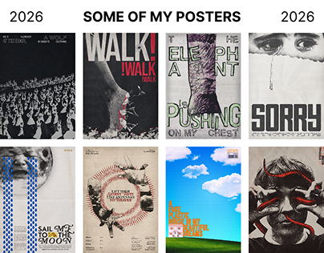

# Eight experimental posters: distressed type, cut-out figures, red thread and a Windows-like sky

**Discipline:** print-social ·  · **Design style:** Minimalist
**Tags:** posters, experimental, black-and-white, red, distressed, collage, portfolio, grid

## What it is
A white slide titled 'SOME OF MY POSTERS' with two rows of four portrait posters: crowds of figures, a foot with red lines, an arm with 'The elephant is pushing on my chest', 'SORRY' in heavy type over a crying eye, a blue pattern 'Sail me to the moon', a circular red-lined collage, a blue sky with clouds, and a face wrapped in red snakes.

## What it means
Moody and expressive; most posters are monochrome with one red or blue accent.

## Techniques
- Limit posters to black and white with a single accent.
- Distress and crop type to match emotion.
- Use one red drawn line across images.
- Show a set in an aligned grid.

## Best for
- Poster portfolios
- Emotive editorial design
- Experimental typography

## Vocabulary
- **Distressed type** — Lettering with worn or rough texture.
- **Accent thread** — A single coloured line across a mono image.
- **Poster grid** — A set of posters shown together.
- **Emotive crop** — A close crop chosen for feeling.
