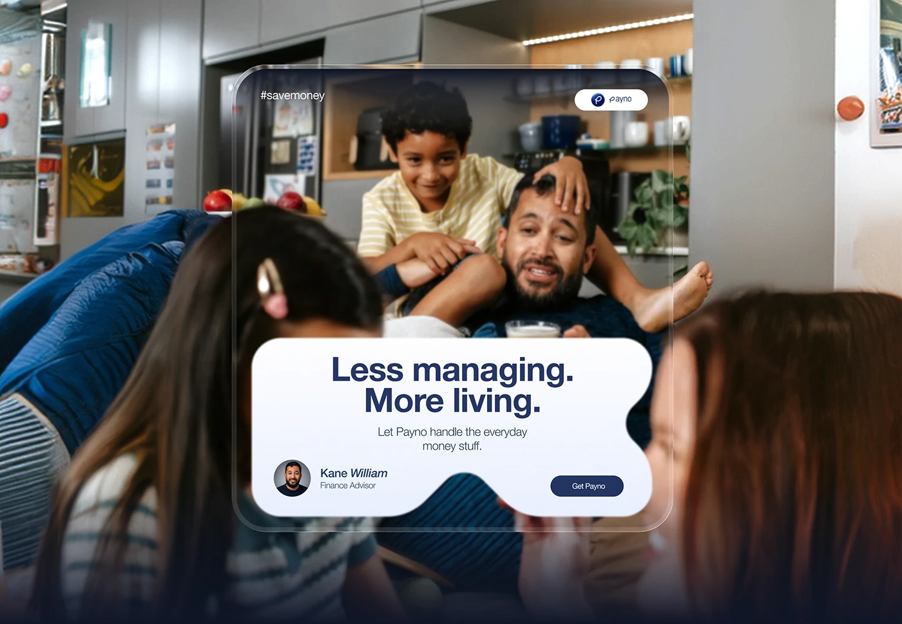

# Family Photo with Glass Frame and Blob Card

**Discipline:** print-social · **Design type:** Social ad
**Tags:** family, glass-frame, blob, navy, fintech, photography, ad

## What it is
A candid family scene in a kitchen with a thin glass frame around the centre, a hashtag and brand pill at the top, and a white blob-shaped card overlapping the lower edge with the headline 'Less managing. More living.', an advisor avatar and a Get button.

## What it means
A warm candid photo with a soft blob card feels human and reassuring, and the frame focuses on the play moment.

## Techniques
- Glass frame highlighting the centre of a photo
- Blob-shaped card cut by the photo elements
- Blurred foreground family members for depth
- Headline with bold sans and italic name
- Brand pill and hashtag in the frame corners

## Best for
- Lifestyle-led fintech ads
- Family and household campaigns
- Social ads with human moments

## Vocabulary
- **Glass frame** — A thin translucent border framing part of an image.
- **Blob card** — A card with soft irregular contour edges.
- **Foreground blur** — Out-of-focus objects in front of the subject.
