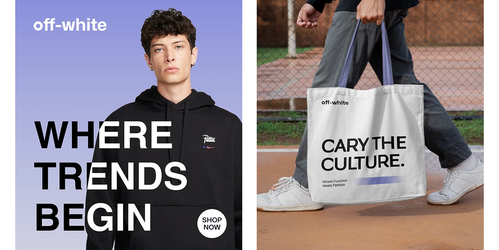

# Periwinkle gradient fashion ad with black and white headline over a hoodie model and a matching tote in motion

**Discipline:** print-social ·  · **Design style:** Gradient & Aurora
**Tags:** fashion, periwinkle, gradient, headline-over-model, tote, street, white-black-type, campaign

## What it is
Two images: a periwinkle-gradient portrait of a model in a black hoodie with a huge 'WHERE TRENDS BEGIN' whose letters switch black and white over the body and a round SHOP NOW disc; and a walking person carrying a white tote printed with 'CARY THE CULTURE.' and a periwinkle bar.

## What it means
Bold and streetwise; type that flips colour where it crosses the black hoodie feels integrated.

## Techniques
- Switch text colour where it crosses a dark garment.
- Use one periwinkle gradient as the backdrop.
- Repeat the type style on merch.
- Add a round SHOP NOW disc.

## Best for
- Fashion campaign visuals
- Merch and tote design
- Type-over-photo ads

## Vocabulary
- **Colour-flip type** — Text that changes colour where it overlaps a dark area.
- **Shop disc** — A round white call-to-action badge.
- **Merch echo** — Reusing ad type on products.
- **Gradient backdrop** — A vertical colour blend behind a model.
