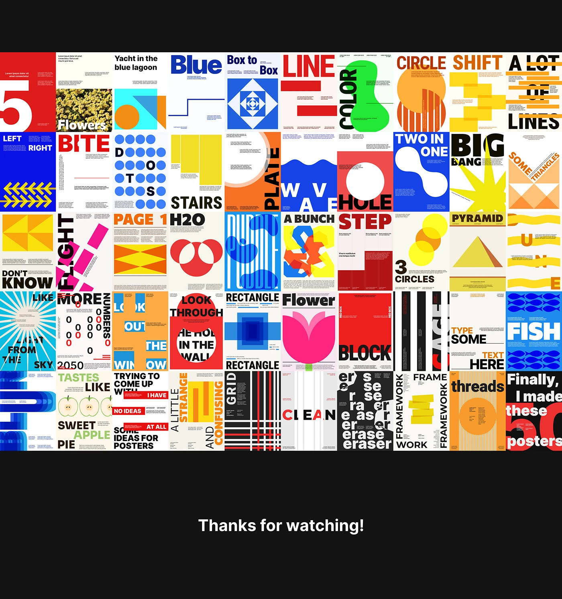

# Wall of fifty geometric poster experiments in primary colours

**Discipline:** print-social ·  · **Design style:** Geometric & Bauhaus
**Tags:** posters, grid, primary-colours, geometric, experiments, type-driven, modernist, series

## What it is
A black slide with a ten-by-five grid of small poster designs: red, blue, yellow, black and cream, each using a word and simple geometry (circles, stairs, waves, dots, lines, flowers, fish) with type distorted to match. 'Thanks for watching!' ends the slide.

## What it means
Playful and disciplined; a shared palette of primaries and a one-word-one-shape rule make fifty ideas feel like one family.

## Techniques
- Pair each poster with one word and one visual idea (word-image mapping).
- Use a strict palette of red, blue, yellow, black and cream.
- Bend, crop and repeat type to illustrate its meaning.
- Show many posters in a grid to prove range.

## Best for
- Typography and poster practice series
- Design education and portfolio slides
- Idea-generation exercises

## Vocabulary
- **Word-image mapping** — Making the layout depict the word it shows.
- **Primary palette** — Red, yellow and blue with black and cream.
- **Poster series** — A set of designs made under shared constraints.
- **Grid overview** — Showing many works together at small size.
