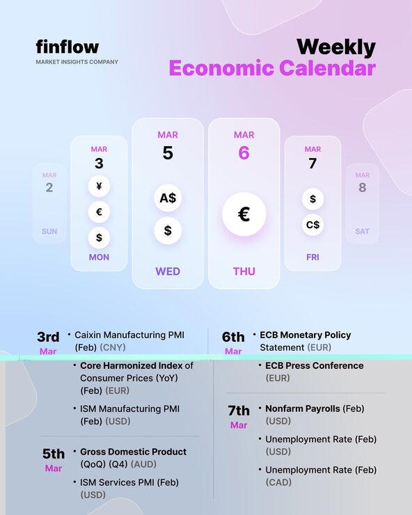

# 'finflow' Weekly Economic Calendar with pastel glass day cards and currency bubbles

**Discipline:** print-social · **Design type:** Social educational post · **Design style:** Glassmorphism
**Tags:** finance, calendar, pastel, glass, currency, economics

## What it is
A portrait post on a pale blue-to-lilac gradient with 'finflow' branding, a black and magenta 'Weekly Economic Calendar' title, a row of frosted glass day cards (Mar 2–8) sized by importance, each holding white currency bubbles (¥, €, $, A$, C$) with Thursday's euro enlarged, and a two-column list of events by date below.

## What it means
Light and approachable; soft glass cards make dense economic data feel friendly.

## Techniques
- Size day cards by importance with the key day largest.
- Show currencies as white circle bubbles.
- Fade outer days to focus the week.
- Follow the visual with a dated two-column list.

## Best for
- Finance newsletters
- Trading education
- Weekly calendars

## Vocabulary
- **Emphasis scaling** — Making important items bigger.
- **Currency symbol** — A sign such as $, € or ¥.
