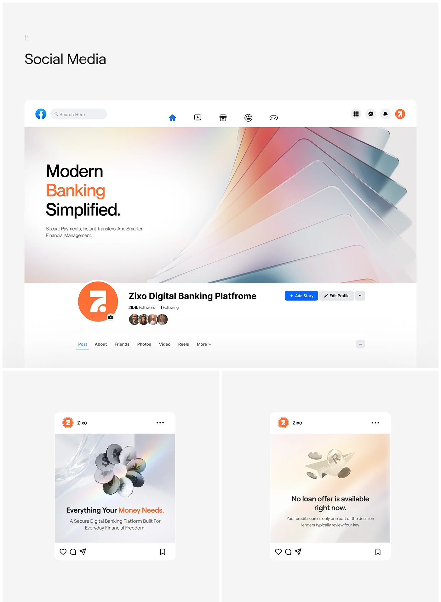

# Fintech social profile and post kit with glass-card 3D

**Discipline:** print-social ·  · **Design style:** 3D & Surreal
**Tags:** social-media, profile-cover, fintech, 3d-render, glass, orange-accent, brand-application, mockup

## What it is
A presentation board showing a digital-bank brand applied to social media: a Facebook-style profile with a wide banner of translucent gradient glass cards, an orange circular avatar, and two square feed posts with 3D metallic coins and a paper plane. Headlines are black with one orange keyword.

## What it means
It feels modern, clean and trustworthy while still premium. Iridescent glass and soft light suggest transparency and simplicity for a money product; the single orange accent keeps it friendly and recognizable.

## Techniques
- Colour one keyword in the headline with the brand accent so every post has an instant focal point.
- Use a single abstract 3D render (fanned glass panels, coins) as a wide banner that crops gracefully across formats.
- Keep a pale grey-white base with soft pastel gradients so the accent colour and avatar pop.
- Present social assets inside realistic platform chrome so the client sees them in context.
- Reuse one template (icon + header, 3D object, two-line headline, small subline) across every post.

## Best for
- Fintech, banking and payments brands
- Brand guideline decks and case studies showing social rollout
- Tech brands that need a premium-but-approachable feed

## Vocabulary
- **Glass card** — A translucent, softly blurred panel with light edges that mimics frosted glass.
- **Accent keyword** — One word in a headline coloured with the brand accent to guide the eye.
- **Profile banner** — The wide cover image at the top of a social profile.
- **Context mockup** — Showing a design inside a realistic interface or object instead of flat.
