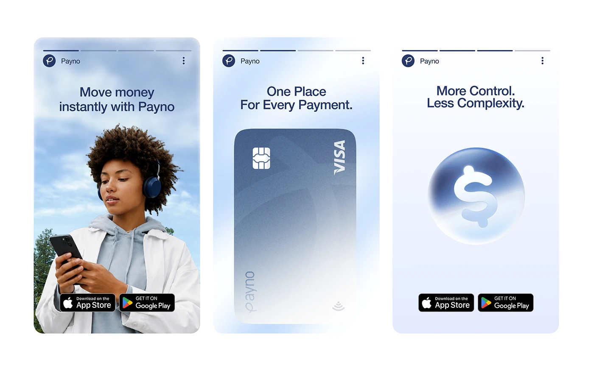

# Three soft pastel story cards for a fintech app

**Discipline:** print-social ·  · **Design style:** Glassmorphism
**Tags:** stories, fintech, pastel-blue, portrait-photo, 3d-card, glass-orb, app-badges

## What it is
Three tall rounded story cards with progress bars at the top and brand header. One has a person with headphones against clouds, one a blurred gradient credit card, one a glass orb with a dollar sign. Each has a two-line headline and app store badges.

## What it means
Airy and reassuring; soft skies and glass objects communicate calm control of money.

## Techniques
- Use a soft sky-blue gradient across all cards.
- Pair one photographic card with two 3D or glass object cards.
- Add story progress bars to sell the format.
- Keep headlines short two-liners with contrasting statements.

## Best for
- Fintech app promotion
- Instagram or in-app stories
- Cohesive three-part sequences

## Vocabulary
- **Progress segments** — Thin bars at the top showing story position.
- **Glass orb** — A translucent sphere with a symbol inside.
- **Parallel headlines** — Short phrases with matching structure.
- **Store badges** — App Store and Google Play buttons.
