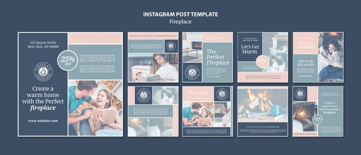

# Fireplace home pack in slate blue and blush with cosy photos and italic script words

**Discipline:** print-social · **Design type:** Social template pack · **Design style:** Warm & Organic
**Tags:** home, fireplace, slate, blush, cosy, serif, instagram

## What it is
Nine square posts with a slate blue and blush palette, cosy photos of couples and a woman reading by a fire, serif headlines with italic accents ('Create a warm home with the Perfect fireplace'), circle '25% off' badges and a round fireplace logo.

## What it means
Soft and inviting; muted cool tones framing warm firelight feel serene and homely.

## Techniques
- Frame warm photos with cool muted panels.
- Italicise the key noun in a serif headline.
- Use a round logo seal and matching discount circle.

## Best for
- Home and interior brands
- Fireplace or heating retailers
- Seasonal cosy campaigns

## Vocabulary
- **Muted palette** — Low-saturation colours for a calm feel.
- **Seal logo** — A circular emblem logo.
