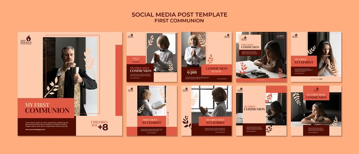

# First Communion pack in peach, coral and maroon with leaf-sprig illustrations

**Discipline:** print-social · **Design type:** Social template pack · **Design style:** Warm & Organic
**Tags:** communion, church, peach, maroon, leaves, serif

## What it is
Nine square posts in peach with coral and maroon blocks, photos of children praying and a priest with a chalice, serif uppercase 'MY FIRST COMMUNION' and 'Eucharist' titles, thin line leaf sprigs and a flame logo.

## What it means
Warm and reverent; soft peach and botanical lines feel gentle for a child's milestone.

## Techniques
- Layer coral and maroon blocks under text.
- Add thin line botanical sprigs.
- Use an offset line frame around photos.

## Best for
- Religious milestones
- Church event invites
- Family ceremonies

## Vocabulary
- **Sprig** — A small illustrated branch of leaves.
- **Colour block** — A solid rectangle of colour.
