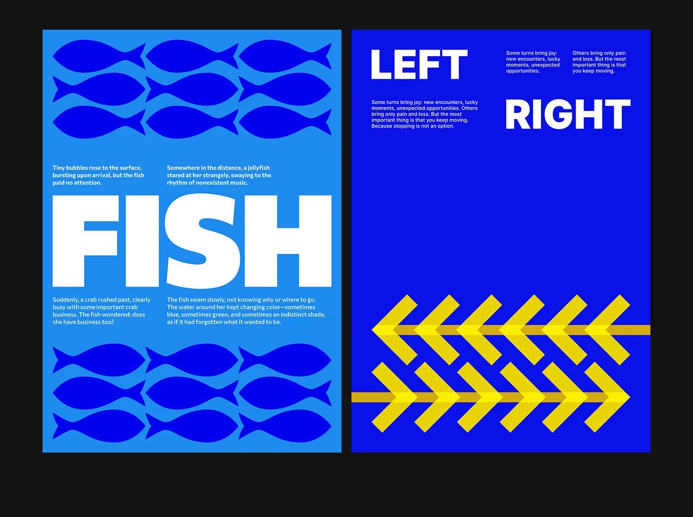

# Two blue posters: repeated fish silhouettes around a giant FISH, and yellow arrows pointing LEFT and RIGHT

**Discipline:** print-social · **Design type:** Typographic posters
**Tags:** posters, blue, yellow, pattern, arrows, giant-type, white-type, geometric

## What it is
On black, two portrait posters. The left is sky blue with two blocks of nine navy fish silhouettes and a huge white 'FISH' between small story paragraphs. The right is deep blue with 'LEFT' and 'RIGHT' in white and two rows of yellow chevrons pointing opposite ways over lines.

## What it means
Bold and witty; shapes and words say the same thing at monumental scale.

## Techniques
- Tile a simple silhouette into a block pattern.
- Set one huge white word across the centre.
- Use chevrons on a line as directional graphics.
- Keep small two-column body text as texture.

## Best for
- Typography and poster series
- Word-and-image concept posters
- Blue-based graphics

## Vocabulary
- **Silhouette pattern** — A repeat of a solid shape.
- **Directional chevrons** — Arrow-like marks indicating direction.
- **Monumental word** — A single word set at poster scale.
- **Two-column micro text** — Small columns of story text.
